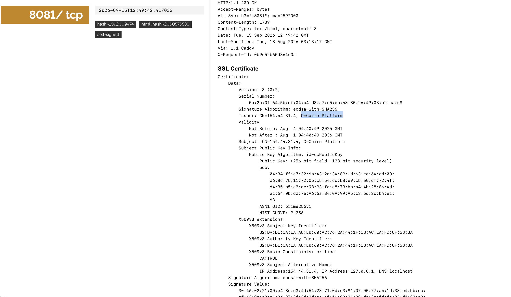
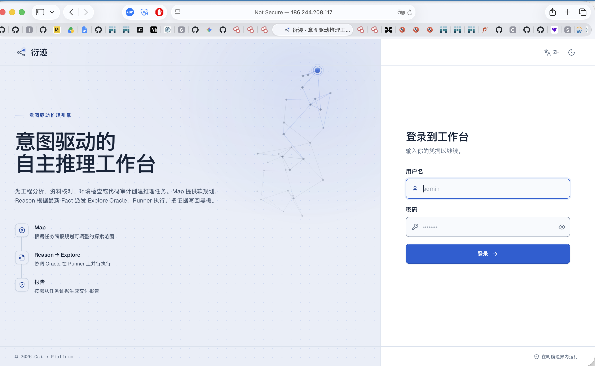
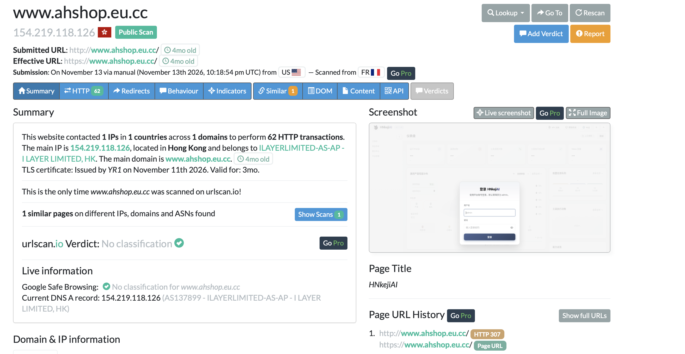
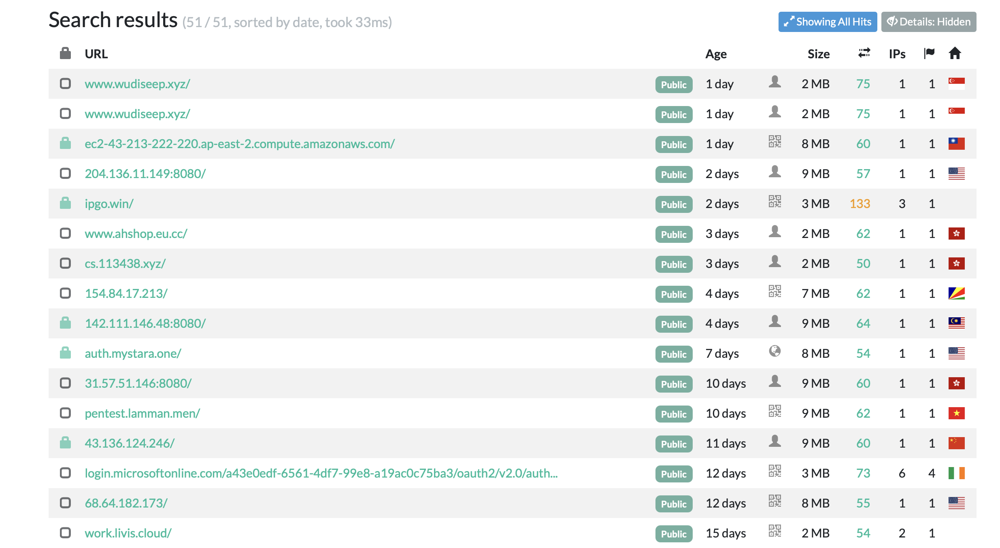
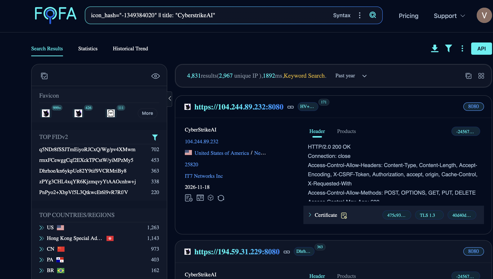
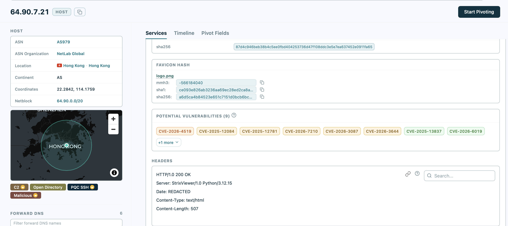

# Hunting Autonomous AI-Driven Pentesting Frameworks


Over the last few months, we've seen a proliferation of AI-driven pentesting frameworks used to conduct attacks on organizations, business, and government agencies. Many of the world's best security research teams have reported these extensively, such as Microsoft, GTIG, Wiz, Palo Alto Networks' Unit42, Zscaler's Threatlabz, Amazon Threat Intelligence and Crowdstrike. The most popular is Artex, and its numerous forks and variants have been used by different threat actors such as Storm-0940/UNC7228 and other Chinese-speaking attackers. 
That one's been explored multiple times, so we'll be tracking 3 others - Cairn, CyberStrikeAI, and Strix. Each of these has been used in attacks, but none have gotten the same degree of coverage. 

A lot of them are exceptionally well written, with integrations for internet-wide scanning, querying the same services we're using to hunt them down, such as Shodan, and multiple LLM tools that can be rotated to keep their hands relatively close to the vest. We'll see them evolve further, but here's what hunting them down looks like, right now. 

Note: 
Before we get started, I'd like to highlight that the presence of an AI-Pentesting framework does not mean that its mautomatically malicious. It could be experimental, it could be directed towards something fully private or a target that is being hardened with full knowledge of incoming attacks. All we do here, is identify. 


## Cairn

Cairn has been used quite recently in intrusions, so we can pick up some IOCs from [https://unit42.paloaltonetworks.com/cairn-framework-ai-autonomous-attacks/](https://unit42.paloaltonetworks.com/cairn-framework-ai-autonomous-attacks/): 


154.44.31[.]4 - Cairn hosting server (HK, AS979, NetLab Global)
82.29.129[.]54 - Staging server and attack egress (US, AS142036, Hosteons Pte. Ltd.)


Shodan has a record for 154.44.31.4, but nothing suggesting Cairn until you open the Timeline tab, which shows that port 8081 was hosting Cairn but is no longer visible. 

Port 8081 on 154.44.31.4:




Click here for a Basic Query for [Cairn on Shodan](https://www.shodan.io/search?query=ssl%3A%22Cairn+Platform%22).


From this, we can pick out 186[.]244[.]208.117 - search on urlscan.io for https[:]//186[.]244.208.117/login



New IOCs from urlscan.io: 38[.]76.170.211, 101[.]251.178.216

Two searches work well on Modat:

```py title="Modat queries for Cairn"
same_service(protocol="http" transport="tcp" tls.subject.common_name~"Cairn auto-generated TLS certificate") or same_service(protocol="http" transport="tcp" tls.subject.organization="Cairn Platform") 


same_service(protocol="http" transport="tcp" http.title="衍迹 · 自主探索工作台")  [Translates to Evolutionary Traces · Autonomous Exploration Workbench] 
```

|IP |Forward DNS|
| :---: | :---: |
|38.76.168.15||	
|38.76.170.171||	
|154.64.250.154|zhonghk[.]sunip.top, cdn[.]svop.cc|
|154.44.31.104|wo[.]369888.net, kk64421[.]top, *[.]qfggo.sbs, www[.]369888.net, 520[.]xn--psvq89a.top, admin[.]369888.net, web[.]369888.net, caiji[.]369888.net|
|189.24.71.89||
|64.90.9.26||
|124.221.7.40||
|101.251.178.220||	
|186.244.208.117||
|154.36.163.130||
|189.24.70.181||	
|38.76.170.211||	
|189.24.71.190||	
|101.251.178.216||	
|64.90.26.146||	
|154.37.218.129||

## CyberstrikeAI


The default certs for CyberStrikeAI have the name 'CyberStrikeAI' - and Shodan gives us 157 [results](https://www.shodan.io/search?query=ssl%3ACyberStrikeAI)


Using the favicon hash is a bit more reliable, and we can find 268 with it 
```
http.favicon.hash:-1349384020
```

CyberStrikeAI is slightly more well established and has been seen several times, so we can see several OSINT engines have excellent tags for it, such as Modat. 

Modat: 
```
http.favicon.mmh3=-1349384020 and http.title~"cyberstrike"
``` 
This has 1738 hits as of the moment of testing, so let's try to find others.
We can investigate the endpoints that aren't tagged for further indicators. 

```py title="Untagged CyberStrike on Modat"
http.favicon.mmh3=-1349384020 and not fingerprints.service.product="CyberStrikeAI"
```

Worth noting that the distribution is across a handful of across countries (US, HK, CN, JP) and the ports used are fairly common (18080 is a common one, while port 8080 is default).
We can submit the Forward DNS associated with this IP on urlscan.io: 154.219.118.126 (www[.]ahshop.eu[.]cc) and see the panel for ourselves, plus we can pull up one of the IOC hashes and see if urlscan has other hits - note that this panel does not have the default title. 




We can use the hash of the favicon to search for other results, even those that might have another name.

[Click here to see the URLScan Search for Favicon Hash 483ddc84a99698971d21d4ac6eb6057fbedb575ab12d7cff51434b305665d4b7](https://urlscan.io/search/#hash%3A483ddc84a99698971d21d4ac6eb6057fbedb575ab12d7cff51434b305665d4b7)

This yields another 51 results for CyberStrikeAI, often with different panel names. 




Let's Pivot to FOFA to see if we can find others. 

```
icon_hash="-1349384020" || title: "CyberstrikeAI" 
```



This yields around 4800 hits! We've definitely found many new ones, but with a number this large, we definitely want to sift through the chaff - and this header is common to all of the interesting endpoints. 

```py title="Headers Common to Multiple AI Agents, For The Curious"
HTTP/1.1 200 OK
Access-Control-Allow-Headers: Content-Type, Content-Length, Accept-Encoding, X-CSRF-Token, Authorization, accept, origin, Cache-Control, X-Requested-With
Access-Control-Allow-Methods: POST, OPTIONS, GET, PUT, DELETE
Access-Control-Max-Age: 600
Content-Type: text/html; charset=utf-8
Transfer-Encoding: chunked
```

What's interesting is that these headers do an excellent job of narrowing down multiple AI Pentesting endpoints, possibly through a shared library they all use, which I would leave to the reader for investigation. 


Other queries that might work, based on other artifacts: 

```
Censys: host.services.endpoints.http.headers.key:"X-Implant-Token" 
Fofa: "X-Implant-Token:" 
``` 


```py title="CyberStrike AI IOCs"
156.233.235.164 
64.83.34.48 
154.219.118.213 
23.132.132.45 
134.122.140.17 
43.163.206.17 
45.207.196.108 
23.153.36.167 
154.12.30.12 
87.83.207.242 
139.99.77.8 
118.107.1.214 
103.42.180.166 
38.55.150.245 
198.44.179.90 
103.75.116.42 
154.219.118.126 
43.250.173.238 
206.187.194.30 
193.112.19.66 
129.204.196.114 
189.105.72.215 
23.153.36.230 
64.81.30.146 
43.240.15.169 
186.241.121.142 
186.241.121.93 
186.241.121.17 
23.132.132.30 
23.225.236.21 
```

## Strix

For Strix, we can start with this common title on Modat that we can find in Strix's github repo, in strix/interface/viewer/frontend/index.html.

```
same_service(protocol="http" transport="tcp" http.title~"Strix Results")
```

This returns 45 results, let's see if there are more. 


Investigating one of the endpoints, we can find two further pieces of information that can be used to look further. 
1. The favicon hash is a6d5ca4b84523e651c7151d0bcb6bc0c132ecc311566bb48ed2da6c82efcb9eb
2. The headers have a very specific server config returned: Server: StrixViewer/1.0




If we ran the same check on Shodan, we could use these headers to look for Strix:

```
HTTP/1.0 200 OK
Server: StrixViewer/1.0 Python/3.12.3
Content-Type: text/html
Content-Length: 507
```

There is, however, one sample that has the right title, but doesn't use the StrixViewer server config - worth nothing despite having the same content-length of 507. 


```py title="Strix IOCs"
102.165.46.161
103.106.191.166
103.116.245.86
103.19.190.241
103.83.86.254
108.187.6.7
108.187.6.9
109.122.18.186
13.140.137.222
148.251.253.126
154.12.17.209
154.217.234.117
156.239.8.158
156.239.8.159
158.247.241.87
167.99.0.98
169.58.63.209
173.249.9.140
178.18.249.205
180.93.127.251
185.215.180.57
192.189.2.101
193.111.117.98
194.59.31.150
2.29.51.16
2.29.97.130
20.124.33.198
206.188.197.83
206.238.123.32
207.56.20.238
209.99.191.116
212.43.155.143
23.88.114.165
23.94.28.167
23.95.197.222
31.77.229.26
45.61.139.194
45.63.121.217
5.175.253.226
5.231.253.96
64.118.142.172
64.90.7.21
69.48.203.140
69.80.225.67
72.5.43.140
79.143.181.86
82.158.91.19
85.239.147.8
89.124.121.167
91.92.33.119
209.222.97.126
209.99.191.116
64.118.142.172
```

Conclusion:

1. Several parameters or pseudo-IOCs are configurable. When the repositories are public, it's worth investing time to find which parameters can be and ARE frequently modified. 
2. In many cases it is observed that multiple AI Pentesting Frameworks are deployed on the same IP address, with a different port. This can yield direction at times when some of the obvious ones hit dead ends. 
3. Right now, AI agents are noisy, and hard to ignore even if they're exceptionally quick - but the subtlety might be coming in soon, and at that point defenders will have to update their playbooks. 


